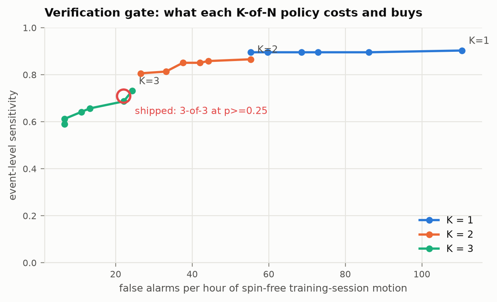

# IMU-Based Assistance Dog Alert Verification and Emergency Escalation System

A wearable collar for trained seizure-alert assistance dogs that detects the
dog's trained alert behaviour, verifies it across several seconds of motion, and
**escalates to a caregiver or emergency contact if the owner cannot respond**.

> A trained alert dog only helps if a human notices the signal. The situation the
> dog is trained for — the owner is about to have a seizure — is exactly the
> situation in which the owner may be unable to notice anything. Detection
> without escalation solves the easy half of the problem.

---

## What is ours and what is not

This project builds on a published proof-of-concept and says so explicitly.

| Layer | Origin |
|---|---|
| Feasibility of IMU spin-alert detection | Brady et al., *Animals* **2025**, 15, 3081 ([DOI](https://doi.org/10.3390/ani15213081)) |
| The dataset (135 labelled spins, 6 dogs) | [figshare 30022441](https://doi.org/10.6084/m9.figshare.30022441), released by the same authors |
| Our detection pipeline | Re-implemented and re-trained from scratch on that data |
| **Multi-stage verification gate** | **Ours** |
| **Owner → caregiver → emergency escalation** | **Ours** |
| **Relay node, backend, caregiver dashboard** | **Ours** |
| **ESP32 firmware and the Python→C model export** | **Ours** |

The source study ends at detection. Its own discussion identifies transmitting
alerts "to owners, caregivers or emergency services" as future work. That gap is
this project.

## Headline results

All numbers come from `make all-research` and are cited from
`ml/artifacts/*.json`, `escalation/artifacts/simulation.json` and
`formal/results.json`. The research write-up is the manuscript in
[`paper/`](paper/) (MDPI *Sensors* format); see
[docs/11-research.md](docs/11-research.md).

| | Deployed forest (32 trees) | Heuristic baseline |
|---|---|---|
| Segment F1, leave-one-group-out | **0.649** [[0.562, 0.728]] | 0.582 |
| Event recall, leave-one-group-out | **0.896** [[0.760, 0.987]] | 0.881 |
| Gate, nested selection: event sensitivity | **0.731** | 0.619 |
| Continuous recordings, no refractory: false alarms/h | **60.4** | 92.2 |
| Continuous recordings, 60 s refractory: episodes detected / FA/h | 0.641 / 28.6 | 0.641 / 23.8 |

Bracketed values are 95% cluster-bootstrap intervals over recording groups.

- **The curated-clip protocol understates false alarms.** Scored on continuous
  recordings, the detector raises 2.7× the false alarms the
  curated protocol implies (22.1/h).
- **Escalation is formally verified.** 26 TLA⁺/TLC checks
  confirm the ladder's safety. They also exposed a watchdog flaw that bypasses
  the caregiver when the phone fails, and an integration bug that disabled the
  watchdog; the bug is now fixed.
- **Detection is the bottleneck.** In simulation, escalation reaches a human
  within 5 minutes for 99.2% of
  *detected* alerts when the owner cannot respond. Keeping caregiver pages to
  one a week needs at most **0.023 false alarms/h**, which is
  1,222× below the measured training-session rate.

That last gap is why the architecture requires an owner acknowledgement before
anyone else is contacted, and it is the main finding of the research.



## Try it in three commands

```bash
pip install -r requirements.txt

# 1. Train and evaluate the detection layer (~20 s)
python ml/scripts/run_experiments.py

# 2. Watch a real recording escalate because the owner never responded
python gateway/replay.py --scenario asleep
```

```
   111.2  collar: verification gate fired (2/4 windows, confidence 0.67)
   111.2  alert e5c328 -> PENDING_OWNER
   111.2  notified OWNER (owner-1) -- delivered
   171.4  alert e5c328 -> PENDING_CAREGIVER
   171.4  notified CAREGIVER (care-1) -- delivered
   292.3  alert e5c328 -> ESCALATED_EMERGENCY
   292.3  notified EMERGENCY (emerg-1) -- delivered
```

```bash
# 3. Bring up the caregiver dashboard with a seeded history
python tools/devserver.py &
python tools/seed_demo.py --backend http://localhost:8080
open http://localhost:8080/
```

## Architecture

```
   ┌────────────────────┐        ┌──────────────────────┐       ┌────────────────────┐
   │  COLLAR (ESP32)    │  BLE   │  RELAY (owner phone) │ HTTPS │  BACKEND (Jakarta) │
   │                    │ ─────▶ │                      │ ────▶ │                    │
   │ MPU6050 @ 51.2 Hz  │        │ owner ack window T1  │       │ audit log          │
   │ 133-sample windows │        │ caregiver window T2  │       │ relay watchdog     │
   │ 20 features        │        │ SMS / push           │       │ caregiver dashboard│
   │ 32-tree forest     │        │ GPS fix              │       │                    │
   │ K-of-N gate        │        │                      │       │                    │
   └────────────────────┘        └──────────────────────┘       └────────────────────┘
        detection                  escalation ladder                 the record
```

The escalation ladder runs **on the phone**, not in the cloud: the alert matters
most where connectivity is worst. The backend runs an independent watchdog for
the case where the phone itself dies. Full rationale in
[docs/02-architecture.md](docs/02-architecture.md).

## Repository layout

| Path | What it is |
|---|---|
| `ml/` | Detection layer: dataset, features, models, evaluation, model export |
| `escalation/` | The escalation state machine — the project's core contribution |
| `firmware/collar/` | ESP32 firmware; the algorithmic core is portable C |
| `firmware/test/` | Host test of that core against golden vectors from the real data |
| `gateway/` | Relay node (phone) and the end-to-end replay harness |
| `backend/` | Jakarta EE 10 / MicroProfile caregiver backend |
| `tools/` | Dev server (stand-in for the Java backend) and demo seeder |
| `dashboard/` | Caregiver-facing alert history |
| `docs/` | Full documentation set — start with `00-index.md` |
| `paper/` | The research manuscript (MDPI *Sensors*), generated numbers, figures, supplementary files |
| `formal/` | TLA⁺ specification of the escalation protocol and the TLC runner |
| `escalation/sim/` | Monte-Carlo simulation of whole alert episodes on the real engine |
| `spinning_dataset/` | The figshare dataset (78 `.pkl` files) |

## Documentation

| Document | Covers |
|---|---|
| [00-index.md](docs/00-index.md) | Reading order and document map |
| [01-project-report.md](docs/01-project-report.md) | The full technical report |
| [02-architecture.md](docs/02-architecture.md) | System design and the decisions behind it |
| [03-detection-pipeline.md](docs/03-detection-pipeline.md) | Signal processing and machine learning |
| [04-escalation-protocol.md](docs/04-escalation-protocol.md) | The state machine, formally |
| [05-hardware.md](docs/05-hardware.md) | Bill of materials, wiring, power budget |
| [06-api.md](docs/06-api.md) | REST contract |
| [07-evaluation.md](docs/07-evaluation.md) | Results, with the caveats stated plainly |
| [08-literature.md](docs/08-literature.md) | Related work across five research areas, with an annotated bibliography |
| [09-limitations.md](docs/09-limitations.md) | What this is not, and what would have to change |
| [10-developer-guide.md](docs/10-developer-guide.md) | **Full developer guide** — setup, recipes, extension points, debugging |

## Verification status

| Component | Status |
|---|---|
| `ml/` (114 tests) | Passing |
| `escalation/` (71 tests, incl. 10k-example property tests) | Passing |
| `gateway/` (relay regression test) | Passing |
| `formal/` (26 TLC checks) | All as expected |
| `firmware/` core (240 checks) | Passing — C verified against Python on 64 real windows |
| Replay, 4 scenarios | Passing on real recordings |
| Dev server + dashboard | Verified in-browser |
| `backend/` (Java) | **Not built** — no Maven in this environment; syntax-checked only |

Run everything with `make test`.

## Developer guide

A condensed version follows. The full guide — recipes, extension points,
debugging, performance characteristics, using `escalation` as a standalone
library — is [docs/10-developer-guide.md](docs/10-developer-guide.md).

### Setting up

```bash
pip install -r requirements.txt
make artifacts      # ~30 s: train, export the model, build vectors and figures
make test           # 114 ML + 71 escalation + relay tests, 240 firmware checks
```

Only the ML layer needs third-party packages. `escalation/`, `gateway/` and
`tools/` are standard-library only — deliberately, so the safety path carries no
dependency and the relay can run on a handset with nothing installed.

The dataset is not vendored. Download
[figshare 30022441](https://doi.org/10.6084/m9.figshare.30022441) and unpack it
to `spinning_dataset/`.

### Where to make a change

| You want to… | Edit | Then run |
|---|---|---|
| Change a window size, threshold or timer | `ml/canine_alert/config.py` | `make artifacts` |
| Add or change a feature | `features.py` **and** `firmware/collar/src/ca_features.c` | `make test` |
| Try a different classifier | `models.py` → `build_model()` | `make experiments` |
| Change escalation timings | `gateway/relay_config.json` | `python gateway/replay.py` |
| Add a notification channel (SMS, push) | implement `Notifier.send()` in `notify.py` | `make test-escalation` |
| Change the REST contract | `tools/devserver.py` **and** `backend/.../AlertResource.java` **and** `docs/06-api.md` | `make demo` |
| Change collar pins or sensor config | `firmware/collar/collar.ino` | — (needs hardware) |

### The generated-file chain

Four files are generated and must be regenerated together. `make artifacts` does
it in the right order; doing it by hand in the wrong order produces a firmware
image that disagrees with the evaluation.

```
run_experiments.py ──▶ ml/artifacts/results.json      (metrics + operating point)
                            │
export_firmware_model.py ◀──┘                          reads the operating point
        └──────────────▶ firmware/collar/src/model.h  (forest tables + gate policy)

make_firmware_vectors.py ─▶ firmware/test/vectors.bin (golden I/O from real data)
make_figures.py ──────────▶ docs/figures/*.png
```

Never hand-edit `model.h`. The exporter refuses to write it if the transpiled
forest disagrees with scikit-learn by more than 1e-6.

### Invariants that will bite you

These are enforced by tests. If you break one, something fails loudly — which is
the point, because each was chosen because breaking it silently would be worse.

- **`features.py` and `ca_features.c` must compute the same thing.** The model's
  thresholds were learned on the Python features. `make test-firmware` checks all
  159 against NumPy on real windows. Use two-pass moment calculations in the C —
  the one-pass form loses too much in float32 on a gyro channel.
- **Feature selection is fitted inside each CV fold**, never on the full dataset.
  Fitting it globally leaks test labels into feature *choice*.
- **Escalation timers run on an injected monotonic clock.** Never call
  `time.time()` in `escalation/`. A wall clock that jumps mid-alert makes an
  escalation fire early or never.
- **Alert ids are derived from the episode**, not from arrival time. That is what
  makes a BLE retransmission idempotent instead of a second page.
- **`escalation/` performs no I/O.** Clock and notifier are constructor
  arguments. This is what makes a three-minute ladder testable in microseconds.

### The dev loop

```bash
python gateway/replay.py --scenario asleep     # end-to-end on real data
make demo                                      # dashboard + seeded history
python -m pytest escalation/tests -q -k ack    # focused test run
make -C firmware/test run                      # C/Python parity
```

`replay.py` is the fastest way to see a change's effect on the whole system: it
streams a real recording through windows, classifier, gate and escalation ladder
on a simulated clock, and prints the timeline. Scenarios: `responsive`, `asleep`,
`delayed`, `false-alarm`.

### Two backends

`backend/` (Jakarta EE) is production; `tools/devserver.py` (stdlib) is for
development, CI and demos. They implement the **same** contract in
[docs/06-api.md](docs/06-api.md) — a behavioural difference between them is a bug
in one of them, so change both or neither.

The Java side needs Maven and is not built by `make`:

```bash
mvn -f backend/pom.xml package
mvn -f backend/pom.xml liberty:dev
```

### Code conventions

Comments explain *why*, not *what* — particularly at the places where the obvious
implementation is wrong (float32 moments, the DFT instead of an FFT, the
unsigned `millis()` arithmetic). Tests are named after the failure they prevent,
so a failing test name is a bug report. Anything that would appear in the report
is generated into `ml/artifacts/` and cited from there, never typed by hand.

## Ethics and scope

No animals were involved in this project. All data comes from the published
figshare release, collected under Dublin City University REC approval
(DCUREC/2025/065) and Beaumont Hospital REC 25/16.

**This is a research prototype, not a medical device.** It carries no regulatory
approval, has not been clinically validated, has never run on hardware, and has a
measured false-alarm rate roughly two orders of magnitude worse than
clinically-validated human-worn seizure wearables. It must not be relied upon for
medical decisions. See [docs/09-limitations.md](docs/09-limitations.md).

## Citation

```bibtex
@article{brady2025collar,
  title   = {Development and Validation of an IMU Sensor-Based Behaviour-Alert
             Detection Collar for Assistance Dogs: A Proof-of-Concept Study},
  author  = {Brady, Shelley and Smeaton, Alan F. and Song, Hailin and
             Ward, Tom{\'a}s and Smeaton, Aoife and Dowler, Jennifer},
  journal = {Animals},
  volume  = {15}, number = {21}, pages = {3081}, year = {2025},
  doi     = {10.3390/ani15213081}
}
```
