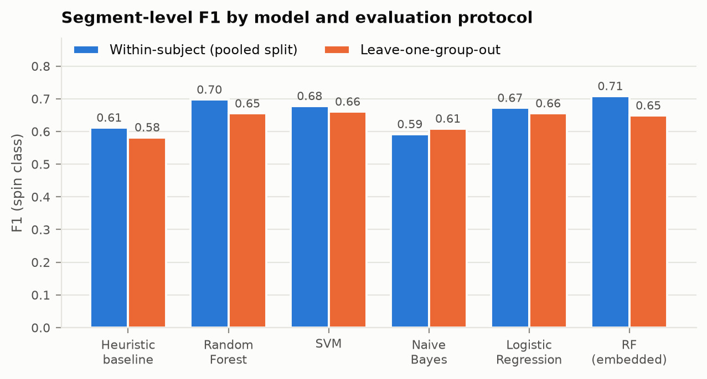
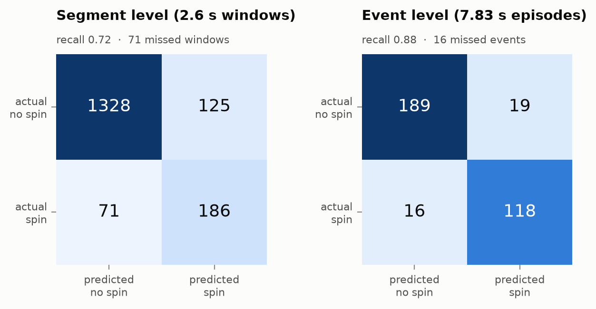

# An IMU-Based Assistance Dog Alert Verification and Emergency Escalation System for Owner Non-Response Scenarios

**Technical report**

Pushkal Gupta · Vanka Kaushik

Source code, data-processing pipeline and evaluation artifacts:
[repository root](../README.md). All reported figures are regenerated by
`make artifacts` and stored in `ml/artifacts/results.json`.

**Keywords:** assistance dogs · seizure alerting · inertial measurement ·
wearable sensing · edge machine learning · alert escalation · Internet of
Medical Things

---

## Abstract

Trained seizure-alert assistance dogs perform a specific learned signal when they
sense an oncoming seizure in their handler. A recent proof-of-concept study
(Brady et al., *Animals* 2025) showed that a collar-mounted inertial measurement
unit and a machine-learning pipeline can detect such a signal reliably across
different dogs. That system, and the literature around it, stops at detection.

This leaves the failure mode the training is meant to cover: the dog signals and
nobody perceives it, because the handler is asleep, alone, or already losing
consciousness. This project takes the published detection concept, re-implements
it on hardware that a student team can build, and adds the missing layer — an
alert verification gate and an automatic escalation ladder that notifies a
caregiver and then an emergency contact, with location, when the owner does not
respond.

We reproduce the detection layer on the authors' released dataset (135 labelled
spin alerts, 2937 s of motion), reaching a leave-one-group-out segment F1 of
0.657 and an event-level recall of 0.881 with a Random Forest — comparable to the
published figures under a protocol we document as weaker in one specific respect.
We then add a K-of-N streaming verification gate, transpile the trained forest
into 39.2 KiB of C and verify the port numerically against scikit-learn on real
data, and specify an escalation state machine whose safety properties are pinned
by 39 tests. On real recordings, an unacknowledged alert reaches an emergency
contact 181 s after the dog spins.

We also report, rather than omit, the measurement that most constrains
deployment: 19.9 false alarms per hour on spin-free training-session motion at
the shipped operating point.

---

## 1. Introduction

### 1.1 Background

Epilepsy affects an estimated 50 million people worldwide. Its defining feature is
unpredictability, and that unpredictability — not the seizures alone — is what
limits independence.

Assistance dogs have emerged as one response. Some dogs reliably alert before a
seizure, apparently responding to volatile organic compounds; controlled work has
shown untrained dogs reacting to pre-seizure odour, and trained seizure-alert dogs
are placed with handlers today.

Two problems have limited this. First, **spontaneous** alerting behaviour varies
between animals and is difficult to validate objectively — accounts are largely
owner-reported. Brady et al. address this by training dogs to perform a
standardised signal (two rapid clockwise spins) and detecting *that*, which is
both consistent and machine-recognisable.

The second problem is the one this project addresses, and it is not a sensing
problem at all.

### 1.2 The problem

**A trained alert is only useful if a human perceives it.**

The scenario the dog is trained for is one in which the handler may be about to
lose consciousness, may be asleep, or may already be seizing. In precisely that
scenario, the handler is the person least able to notice the dog.

So the failure mode is not "the dog did not alert". It is **"the dog alerted and
nobody was there"** — and no improvement to the detector addresses it. A better
classifier detects the signal more reliably for an audience that is not present.

Brady et al.'s discussion identifies transmitting alerts "to owners, caregivers
or emergency services" as future work. That sentence is this project's scope.

### 1.3 Objectives

1. Re-implement and independently validate the published detection method on the
   authors' released dataset.
2. Make it deployable: real-time inference on an ESP32, with a streaming
   verification policy rather than offline aggregation.
3. **Design, specify and test an escalation layer** that notifies a caregiver and
   then an emergency contact, with location, when the owner does not respond.
4. Provide a caregiver-facing record so alert reliability can be tracked over
   time.
5. State honestly what the system does and does not establish.

### 1.4 Contributions

| | Contribution |
|---|---|
| Primary | The alert verification gate and the owner → caregiver → emergency escalation ladder, with a backend watchdog for a dead relay |
| Secondary | A deployable detection layer: 39.2 KiB C forest, numerically verified against scikit-learn on real data |
| Secondary | A longitudinal record of alert reliability and owner responsiveness |
| Methodological | An honest re-evaluation, including a protocol deviation and a false-alarm rate the source work does not report |

---

## 2. Related work

Summarised here across five areas; full treatment, with a note on which sources we
have read in full, in [08-literature.md](08-literature.md).

### 2.1 Do dogs detect seizures?

A scoping review of dogs alerting to epileptic seizures [4] reports alert lead
times from **10 seconds to 5 hours** and accuracies of **70–85%** — but those
figures are owner-reported, and the review's own conclusion is that
methodological rigour in the field is generally poor. An evaluation of a formal
seizure-response-dog training programme found spontaneous alerting emerged in only
**59%** of dogs.

This is precisely why both [1] and this work build on a **trained, standardised**
signal rather than spontaneous behaviour: a spontaneous alert cannot be validated,
a cued two-spin rotation can.

**Consequence.** Everything downstream inherits this uncertainty. We detect *the
dog's signal*, not the seizure. If the dog is wrong, the system is confidently and
promptly wrong — which is a further reason the ladder requires a human
acknowledgement rather than dispatching help autonomously.

### 2.2 Comparison of approaches

| Work | Contribution | Limitation | How this differs |
|---|---|---|---|
| **Brady et al. 2025** [1] | IMU collar detects a trained spin alert across six dogs; LODO accuracy 0.924, F1 0.65; dataset released | Detection only, offline. Their own text names alert transmission as future work | We add real-time on-device inference, a verification gate, and the escalation layer |
| **Raju et al. 2023** [3] | Collar accelerometer, 11 dogs over 107 days; "a step towards automatic alerting" | Per-dog models; accelerometer-only orientation drift; whole-event granularity | Superseded on detection by [1]; the alerting step is not implemented in either |
| **Human seizure wearables** [5,6] | Pooled: **sensitivity 91%, 2.1 false alarms/24 h** (wrist-worn subgroup 93%, 2.5/24 h); ILAE/IFCN validation guidelines exist | Worn by the person; focal seizures poorly detected; mostly *post-onset*; validation largely inpatient | Uses the dog as the sensor, giving a *pre-ictal* signal; addresses response, not only detection |
| **Fall detection / medical alert** [8] | Escalation to caregivers and emergency services with GPS is standard practice | Human-worn; no animal-mediated equivalent | We adopt the pattern rather than inventing it, and place it behind a canine detector |
| **Dog behaviour recognition** [7] | Collar and harness activity classification; ACI and commercial trackers | Continuous *state* estimation; collar placement is the harder case (75% vs 91% at the back) | Detects an intentional trained signal, inside a human-safety loop |
| **TinyML on MCUs** [10] | Random forests suit extreme-edge deployment under tight memory | Generic methods, not this application | 39.2 KiB transpiled forest, numerically verified against scikit-learn on real data |

### 2.3 The gap

Every capability above exists somewhere in the literature. **Escalation is a
solved problem in human-worn safety devices, and trained-signal detection has been
demonstrated in dogs. No system we could find combines them.**

The clearest evidence that the gap is real is that the authors of the detection
work named the missing piece in their own paper and did not build it.

### 2.4 Novelty claim

> Alert escalation is well established in human-worn safety devices, and the
> detection of trained canine signalling behaviour has been demonstrated. We are
> not aware of a system that **combines them** — that detects and verifies a
> service dog's trained alert *and* provides an automatic escalation path for when
> the owner cannot respond, which is the failure scenario the alert-dog training
> exists to cover.

We explicitly do **not** claim that the detection method is novel (it is [1]'s,
re-implemented), that alert escalation is novel (§2.2), or that a literature
search proves absence.

### 2.5 One prior finding that shaped the design

Work on ambient fall detection for people with cognitive changes reports that
families **preferred escalation to a "circle of friends" over automatic emergency
dispatch**. This is empirical support for the caregiver tier sitting between owner
and emergency services, and for our position that the emergency channel should
address a named human or an accredited monitoring provider rather than dialling
emergency services directly.

---

## 3. Methodology

### 3.1 System overview

A three-node system. Full rationale in [02-architecture.md](02-architecture.md).

```
COLLAR (ESP32 + MPU6050)  ──BLE──▶  RELAY (owner's phone)  ──HTTPS──▶  BACKEND
  sample 51.2 Hz                      T1 = 60 s owner window            audit log
  2.6 s windows / 1.3 s stride        T2 = 120 s caregiver window       watchdog
  20 features → 32-tree forest        SMS / push + GPS                  dashboard
  2-of-4 verification gate            15 s heartbeat
```

**The key design decision** is that the escalation ladder runs on the phone, not
in the cloud. The alert matters most where connectivity is worst — at home at
night, rurally, in a basement — and the owner's acknowledgement is a local
interaction. The cost is that the phone becomes a single point of failure, which
the backend watchdog covers by escalating when a relay stops heartbeating with an
alert open. The two paths are redundant, not sequential.

### 3.2 Dataset

The figshare release accompanying Brady et al.: 78 files, three sessions, two
Shimmer3 units, **135 annotated spin alerts** across 2937 s of motion.

We independently confirm the annotation count and the duration statistics, and in
doing so found a discrepancy: the data is clocked at **51.2 Hz**, not the 50 Hz
the paper assumes. Every reported duration is consequently 2.4% short. We use the
measured rate, so our 2.6 s window is 133 samples of real time rather than 130 of
assumed time. A regression test pins the relationship.

**The release does not carry dog identities.** A literal Leave-One-Dog-Out split
therefore cannot be reproduced from public data. We substitute Leave-One-Group-Out
over recording groups, which is honest about episode- and recording-level leakage
but cannot guarantee that two recordings of the same dog land in different folds.
This is the single largest threat to the validity of our cross-subject results and
is stated wherever those results appear.

### 3.3 Detection pipeline

Full detail in [03-detection-pipeline.md](03-detection-pipeline.md).

| Stage | Choice | Source |
|---|---|---|
| Channels | 3-axis accel + 3-axis gyro | Paper (and MPU6050 has nothing more) |
| Event curation | 401-sample pure events, 1 s guard around negatives | Paper, geometry corrected |
| Windows | 133 samples (2.6 s), stride 67 (1.3 s), ≥50% rule | Paper |
| Features | 159: 8 signals × (13 time + 5 frequency) + 15 correlations | Extends the paper |
| Selection | variance → collinearity (\|r\|>0.95) → ANOVA top-20 | Paper |
| Models | RF, SVM, Naive Bayes, Logistic Regression + heuristic baseline | Paper |
| **Verification** | **K-of-N streaming gate + refractory period** | **Ours** |

Two signals are rotation-invariant magnitudes, `|a|` and `|g|`, because a collar
rotates freely around a dog's neck between fittings and per-axis features do not
survive that. The selector picks three magnitude features unprompted.

Feature selection, scaling and fitting all occur **inside** each CV fold.

### 3.4 The verification gate (ours)

The paper aggregates window predictions offline. We make it a streaming policy on
the collar, because the escalation layer needs a single well-defined moment at
which an alert exists — "the model was mostly positive over the last eight
seconds" is not something a state machine can start a timer on.

```
every 1.3 s:  vote ← p(spin) ≥ 0.45
              if 2 of the last 4 windows voted and 60 s since the last alert:
                  raise ALERT(confidence = mean p of the voting windows)
                  clear the evidence buffer
```

Clearing the buffer matters: without it the gate re-fires on stale evidence the
instant the refractory period ends, turning one episode into a repeating page.

### 3.5 The escalation ladder (ours)

Formally specified in [04-escalation-protocol.md](04-escalation-protocol.md);
39 tests, each named after a real failure mode.

```
ALERT → PENDING_OWNER ──T1 (60 s)──▶ PENDING_CAREGIVER ──T2 (120 s)──▶ ESCALATED_EMERGENCY
             │                              │
        owner acks                   caregiver acks
             ▼                              ▼
   ACKNOWLEDGED_BY_OWNER        ACKNOWLEDGED_BY_CAREGIVER
```

Design commitments, each with a reason:

- **Monotonic clock, injected.** A wall clock can jump (NTP, timezone, user edit);
  against one that jumps, an escalation fires early or never. It also makes a
  three-minute ladder testable in microseconds.
- **At-most-once paging per channel.** A caregiver paged twice for one episode
  learns to ignore the app.
- **Idempotent ingestion.** BLE is at-least-once and the collar retransmits, so an
  alert's identity is a hash of the episode, not of arrival time.
- **Failure escalates, it does not stall.** An unreachable caregiver does not park
  the alert waiting for an acknowledgement that can never come.
- **A late acknowledgement does not unring the bell.** It is recorded; the
  escalation stands.
- **Stale locations are dropped.** A coordinate reads as authoritative; sending a
  responder to where the owner was an hour ago is worse than sending none.

### 3.6 Firmware

The algorithmic core is written as **portable C with no Arduino dependency**, so
it compiles and runs on a host. This is not a stylistic choice: it is what makes
the on-device pipeline verifiable against the Python it must match.

Core 0 does nothing but sample the IMU from a hardware timer; the frequency
features assume a uniform interval, and the eight 133-point DFTs stay on core 1
where being late costs latency rather than correctness.

A direct DFT is used rather than an FFT: 133 samples is not a power of two, and
zero-padding to 256 would change the spectrum — so the device would no longer
compute the features the model was trained on.

---

## 4. Hardware and software

Full detail in [05-hardware.md](05-hardware.md).

| Component | Purpose | ₹ |
|---|---|---|
| ESP32-WROOM-32 | MCU, BLE, dual core | 350 |
| MPU6050 | 6-axis IMU | 120 |
| MicroSD module | Local log when the phone is unreachable | 90 |
| Li-Po 1200 mAh + TP4056 | Power | 450 |
| LEDs, buzzer, strap, enclosure | Indication and mechanical | 350 |
| **Total** | | **≈ ₹1360** |

Deliberately dropped from the previous project's stack: **GPS** (the phone has
one, and a second would cost 37 mA continuously) and **GSM** (2 A peaks; the relay
handles cellular).

| Layer | Technology |
|---|---|
| Collar | Embedded C/C++, Arduino ESP32 core, FreeRTOS |
| Detection | Python 3, scikit-learn, NumPy, SciPy |
| Relay | Python 3 standard library + `bleak` for BLE |
| Backend | Jakarta EE 10, MicroProfile 6.1, Open Liberty |
| Dashboard | Vanilla HTML/CSS/JS, no build step |

---

## 5. Results and discussion

Full treatment, including every caveat, in [07-evaluation.md](07-evaluation.md).

### 5.1 Detection



| Model | Within-subject F1 | LOGO F1 | LOGO ROC-AUC |
|---|---|---|---|
| Heuristic baseline | 0.612 | 0.582 | 0.892 |
| **Random Forest** | 0.697 | 0.657 | 0.896 |
| SVM | 0.678 | **0.661** | 0.876 |
| Naive Bayes | 0.592 | 0.609 | 0.888 |
| Logistic Regression | 0.672 | 0.655 | **0.913** |

The supervised models beat the heuristic baseline, reproducing the paper's central
claim. Within-subject F1 exceeds cross-subject F1 for every model while accuracy
barely moves — also reproducing the paper's finding that the difficulty in
generalising is specifically the minority 'spin' class, not overall correctness.

SVM edges out Random Forest by 0.004. We ship Random Forest anyway: a forest
transpiles to a table of integers an ESP32 can walk, an RBF SVM would need every
support vector in flash.

### 5.2 Why event-level aggregation matters



| | Segment (2.6 s) | Event (7.83 s) |
|---|---|---|
| Missed | **71** (27.6%) | **16** (11.9%) |
| Recall | 0.724 | **0.881** |

The same effect the paper reports. A segment-level metric is the wrong thing to
judge an alerting system by, because an alert is a sustained behaviour rather than
a single-second classification.

### 5.3 The verification gate


| Vote threshold | Policy | Sensitivity | False alarms/hour | Median latency |
|---|---|---|---|---|
| 0.45 | 1-of-N | 0.881 | 46.4 | 1.9 s |
| **0.45** | **2-of-4** | **0.769** | **19.9** | **3.1 s** |
| 0.40 | 3-of-5 | 0.522 | 2.2 | 4.2 s |

Chosen by maximising sensitivity subject to a per-event false-alarm rate ≤ 5%,
rather than by maximising F1 — a missed alert and a spurious one are not
symmetric costs, and F1 pretends they are.

### 5.4 On-device parity

240 checks over 64 real windows (`make -C firmware/test run`):

| Check | Result |
|---|---|
| Transpiled forest vs scikit-learn | max error 8.1 × 10⁻⁹ |
| End-to-end C pipeline vs scikit-learn | max difference 1.8 × 10⁻⁷ |
| Vote decisions differing on-device | **0 of 64** |
| Flash footprint | 39.2 KiB |

This process caught a real bug. The first C implementation computed variance as
`E[x²] − mean²`, which in float32 on a gyro channel at several hundred deg/s loses
most of its significant digits — an error then cubed and raised to the fourth
power by skew and kurtosis. Relative errors reached 5.6 × 10⁻², enough to move a
feature across a split threshold. A two-pass computation brought them under 10⁻³.

### 5.5 End-to-end

`gateway/replay.py` streams a real recording through the entire pipeline on a
simulated clock:

| Scenario | Outcome | Reached |
|---|---|---|
| Owner responds at +9 s | `ACKNOWLEDGED_BY_OWNER` | Owner |
| **Owner never responds** | **`ESCALATED_EMERGENCY` at +181 s** | Owner → Caregiver → Emergency |
| Owner responds at +95 s | `ACKNOWLEDGED_BY_OWNER` | Owner → Caregiver |
| Owner dismisses at +5 s | `DISMISSED_FALSE_POSITIVE` | Owner |

The 181 s matches T1 + T2 exactly, on real motion data, with no hand-placed
events.

### 5.6 The measurement that constrains deployment

**19.9 false alarms per hour** at the shipped operating point. At face value the
collar fires every three minutes.

**The comparison that matters.** Clinically-validated, non-EEG human-worn seizure
detection wearables achieve **0.20–1.92 false alarms per 24 hours**, and
accelerometry for tonic-clonic seizures pools at **2.5 per 24 hours at 93%
sensitivity** [5,6]. Our rate is roughly **two orders of magnitude worse**. The
comparison is not like-for-like — see below — but the gap is far too large to be
explained away by the mismatch, and it is the single clearest statement of how far
this prototype sits from a deployable device.

Three things bear on this, and none makes it acceptable for unsupervised use:

1. **The negatives are the hardest possible ones** — spin-free portions of
   *training-session* recordings, where a dog is being actively cued and is
   seconds from spinning on command. Not a representative sample of a dog's day.
   The true all-day rate is almost certainly much lower; **we have not measured
   it**, and the authors' unlabelled 412.6 h is what would be needed.
2. The 60 s refractory period bounds it at 60/hour by construction and would
   collapse clustered false alarms in continuous deployment — a benefit our
   evaluation cannot apply and does not claim.
3. **This is why the architecture requires an owner acknowledgement before anyone
   else is contacted.** A false alarm costs the owner one dismissal tap. No
   caregiver is paged unless the owner *also* fails to respond within 60 s, and
   the conjunction of those two events is far rarer than either alone.

The escalation design is not incidental to the false-alarm rate. It is the
mitigation for it.

### 5.7 Threats to validity

| Threat | Severity |
|---|---|
| Recording group ≠ dog; true LODO not reproducible | **High** |
| Six dogs, three breeds, one training organisation | **High** |
| False-alarm rate measured only on training-session motion | **High** |
| Operating point chosen on the data it is reported on | Medium |
| Shimmer3 ≠ MPU6050; never validated on hardware | Medium |
| Cued behaviour in a controlled setting | Medium |

---

## 6. Conclusion

We set out to close the gap that a published proof-of-concept explicitly left
open: what happens after a seizure-alert dog signals, if the person it signals to
cannot respond.

We re-implemented the detection layer independently and reached comparable
performance (LOGO segment F1 0.657, event-level recall 0.881), under a protocol we
document as weaker than the original in one specific respect. We made that layer
deployable — 39.2 KiB of C, numerically verified against scikit-learn on real
data, running under a streaming verification gate. And we designed, specified and
tested the escalation layer: an owner acknowledgement window, a caregiver page, an
emergency escalation with location, and a backend watchdog for the case where the
owner's phone dies mid-alert. On real recordings, an unacknowledged alert reaches
an emergency contact 181 seconds after the dog spins.

We also measured something the source work does not report — a false-alarm rate of
19.9 per hour on training-session motion — and it changed how we read our own
system. It is the reason the ladder requires an owner acknowledgement before
anyone else is disturbed, and it is the first thing that must improve.

**What this is not**: a medical device. It is not clinically validated, has never
run on hardware, and has a false-alarm rate too high for unsupervised use. The
ordered next steps are in [09-limitations.md](09-limitations.md); the first is to
obtain the recording-to-dog mapping from the original authors, and the second is
to measure the false-alarm rate on all-day data.

The underlying observation stands regardless. The literature has spent its effort
on making the dog's signal detectable. Making it *heard* is a different problem,
and it is the one that determines whether an alert dog helps.

---

## 7. References

The full annotated bibliography, with a note on which entries we have read in
full and which are cited from an abstract, is in
[08-literature.md §7](08-literature.md#7-references). The principal sources:

1. Brady, S.; Smeaton, A.F.; Song, H.; Ward, T.; Smeaton, A.; Dowler, J.
   Development and Validation of an IMU Sensor-Based Behaviour-Alert Detection
   Collar for Assistance Dogs: A Proof-of-Concept Study. *Animals* **2025**,
   15(21), 3081. doi:10.3390/ani15213081
2. Brady, S. et al. *Package of motion sensor data of spin alert behaviour.*
   figshare. doi:10.6084/m9.figshare.30022441
3. Raju, H.; Sharma, A.; Smeaton, A.; Smeaton, A.F. Automatic Detection of
   Signalling Behaviour from Assistance Dogs as they Forecast the Onset of
   Epileptic Seizures in Humans. *ACM SAC '23*. arXiv:2303.06407
4. Dog alerting and/or responding to epileptic seizures: A scoping review.
   *Epilepsy & Behavior*, 2018. PMID 30513112
5. Automated seizure detection with noninvasive wearable devices: a systematic
   review and meta-analysis. *Epilepsia*, 2022. PMC9545631
6. Non-electroencephalogram-based seizure detection devices: state of the art and
   future perspectives. *Epilepsy & Behavior*, 2023.
7. Dog behaviour classification with movement sensors placed on the harness and
   the collar. *Applied Animal Behaviour Science*, 2021.
8. A Survey of IoT-Based Fall Detection for Aiding Elderly Care: Sensors,
   Methods, Challenges and Future Trends. *Applied Sciences* **2022**, 12(7), 3276.
9. Alarm Fatigue. In *Making Healthcare Safer III*. AHRQ, NBK555522.
10. Optimizing Random Forest-Based Inference on RISC-V MCUs at the Extreme Edge.
    *IEEE TCAD*, 2022. doi:10.1109/TCAD.2022.3199903

---

## Appendix A — Reproducibility

Every figure, table and number in this report is regenerated from the source data
by:

```bash
pip install -r requirements.txt
make artifacts     # experiments, model export, test vectors, figures
make test          # 90 + 63 Python tests, 240 firmware checks
python gateway/replay.py --scenario asleep
```

All randomness is seeded (`random_state = 42`) and the pipeline is deterministic:
a rerun reproduces `ml/artifacts/results.json` byte for byte apart from its
timestamp. Nothing in the documentation is transcribed by hand; each figure cites
the artifact it came from.

The dataset is not redistributed here. It is obtained from figshare
(doi:10.6084/m9.figshare.30022441) and unpacked to `spinning_dataset/`.

## Appendix B — Ethics and data provenance

**No animals were involved in this work.** All motion data comes from the public
figshare release accompanying [1], collected under Dublin City University Research
Ethics Committee approval DCUREC/2025/065 and Beaumont Hospital Research Ethics
Committee approval 25/16. The original authors report that all training and
handling used positive-reinforcement protocols only, with no aversive techniques,
and that welfare indicators (engagement, stress-related behaviours, appetite, rest
quality, willingness to train) were monitored throughout.

**No human participants were recruited for this work.** The escalation layer was
evaluated against simulated owner responses on a synthetic clock, not against
people.

**This system is a research prototype, not a medical device.** It carries no
regulatory approval, has not been clinically validated, has never run on hardware,
and has a measured false-alarm rate roughly two orders of magnitude worse than
clinically-validated human-worn seizure detection wearables. It must not be relied
upon for medical decisions. See [09-limitations.md](09-limitations.md).

## Appendix C — Availability

Source code, the evaluation pipeline, the generated model header, the golden test
vectors and all figures are in the repository. The developer guide is
[10-developer-guide.md](10-developer-guide.md).
