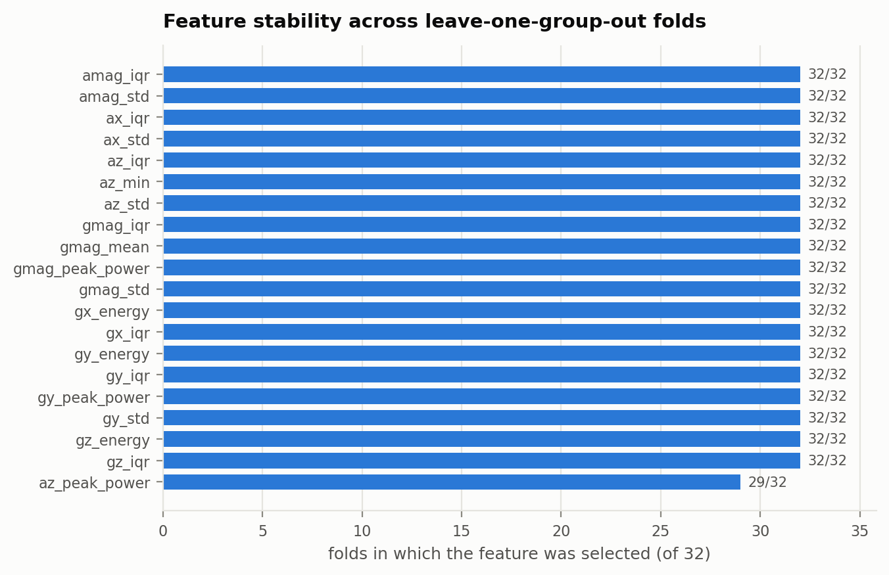

# Evaluation

Every number here is produced by `ml/scripts/run_experiments.py` and stored in
`ml/artifacts/results.json`. Regenerate with `make artifacts`.

---

## 1. The dataset as we found it

| Property | Value |
|---|---|
| Files | 78 `.pkl`, three collection sessions, two Shimmer3 units |
| Annotated spin alerts | **135** |
| Total motion | 2937 s (49 min) |
| Annotated spin time | 340.6 s |
| Sampling rate | **51.2 Hz** (the paper states 50 Hz) |
| Spin duration | 1.00–5.29 s, mean 2.52 s, median 2.46 s |

### 1.1 The sample-rate discrepancy

The paper reports spin durations of 1.02–5.42 s, mean 2.58 s, median 2.52 s. We
measure 1.00–5.29 s, mean 2.52 s, median 2.46 s — uniformly 2.4% shorter.

That factor is exactly 51.2/50. The Shimmer3's divider produces 51.2 Hz, and the
paper's durations were computed by dividing sample counts by a nominal 50 Hz. Our
sample counts agree with theirs exactly; only the conversion differs.

We use the measured rate and derive window lengths from it, so our windows are
2.6 s of *real time* (133 samples) rather than 2.6 s of assumed time (130
samples). `ml/tests/test_dataset.py::test_annotated_durations_match_publication`
asserts this relationship, so the discrepancy cannot be silently reintroduced.

### 1.2 What we could not reconstruct

**The published dataset does not contain dog identities.** The paper reports 135
spins across six named dogs (Stuart 74, Rosie 23, Teddy 16, Ranger 10, Tori 9,
Nadia 3). The figshare release carries only device ID, recording number and part
number. A literal Leave-One-Dog-Out split therefore cannot be reproduced from the
public data.

We substitute **Leave-One-Group-Out** over recording groups
(`<session>/<recording>` — 32 groups that yield events). A recording group is one
continuous capture from one collar on one animal, so:

- it never leaks *within* a behavioural episode, and
- it never leaks *within* a recording,
- but it cannot guarantee that two recordings of the same dog land in different
  folds.

This makes our protocol **weaker than LODO in one specific respect** and not
comparable to the paper's headline numbers on equal terms. Every cross-subject
figure below should be read with that caveat. It is stated here rather than in a
footnote because it is the single largest threat to the validity of these
results.

---

## 2. Protocols

| Protocol | Split unit | What it measures | Honest? |
|---|---|---|---|
| Within-subject | Random over windows | Ceiling. Windows from one episode appear on both sides | No — optimistic by construction |
| Leave-one-group-out | Whole recording groups | Generalisation to an unseen recording | Yes, with §1.2's caveat |
| Event-level | LOGO out-of-fold predictions, aggregated per 7.83 s episode | What the system actually does | Yes |

Feature selection, scaling and fitting all happen **inside** each fold. The paper
does not state whether it did the same; we take the conservative route and
`ml/tests/test_selection.py::test_selection_depends_only_on_training_data`
enforces it.

### 2.1 Segmentation

| Parameter | Value | Source |
|---|---|---|
| Window | 2.6 s = 133 samples | Paper |
| Stride | 1.3 s = 67 samples (50% overlap) | Paper |
| Window label | 'spin' if ≥50% of samples are annotated spin | Paper |
| Curated event | 401 samples = 7.83 s = exactly 5 windows | Paper (7.8 s, "five constituent segments") |

Curated events: 342 total (134 positive, 208 negative), yielding 1710 windows of
which 257 are positive. Negative events keep a 1 s guard from any annotated spin,
so no negative window straddles a behavioural boundary.

---

## 3. Results at a glance

### 3.1 Segment level

| Model | Within-subject F1 | LOGO accuracy | LOGO F1 | LOGO ROC-AUC |
|---|---|---|---|---|
| Heuristic baseline (mean \|gyro\|) | 0.612 | 0.846 | 0.582 | 0.892 |
| **Random Forest** | 0.697 | 0.887 | 0.657 | 0.896 |
| SVM (RBF) | 0.678 | 0.870 | **0.661** | 0.876 |
| Naive Bayes | 0.592 | 0.829 | 0.609 | 0.888 |
| Logistic Regression | 0.672 | 0.870 | 0.655 | **0.913** |
| Random Forest (embedded, 32 trees) | **0.708** | 0.872 | 0.652 | 0.898 |


Two things worth naming:

- **The supervised models beat the heuristic**, reproducing the paper's central
  claim (RF LOGO F1 0.657 vs 0.582). The margin is smaller than the paper's
  (0.65 vs 0.60 accuracy), because our heuristic threshold is tuned per fold on
  the training half, which is a fairer baseline than a fixed threshold.
- **SVM edges out Random Forest on segment F1.** We ship Random Forest anyway:
  the margin is 0.004, RF's `predict` and `predict_proba` agree by construction
  (SVC's do not — see §5), and a forest transpiles to a 39 KiB table of integers
  that an ESP32 can walk, while an RBF SVM would need every support vector in
  flash and a kernel evaluation per inference.

### 3.2 The cost of generalising

Within-subject F1 exceeds LOGO F1 for every model. Accuracy barely moves; F1
drops noticeably. This reproduces the paper's finding exactly: the difficulty in
cross-subject generalisation is not overall correctness — which the majority
'non-spin' class dominates — but specifically identifying the minority 'spin'
class in an animal the model has not seen.

### 3.3 Event level: why temporal aggregation matters


Random Forest, LOGO:

| | Segment level (2.6 s) | Event level (7.83 s) |
|---|---|---|
| True positives | 186 | 118 |
| **False negatives** | **71** | **16** |
| False positives | 123 | 18 |
| True negatives | 1330 | 190 |
| Recall | 0.724 | **0.881** |

Aggregating five windows into one episode cuts the missed-detection rate from
27.6% to 11.9%. This is the same effect the paper reports (121 segment-level
false negatives collapsing to 4 event-level ones) and the reason a
segment-level metric is the wrong thing to judge an alerting system by.

---

## 4. The verification gate (ours)

The paper performs this aggregation offline. We make it an explicit streaming
policy the collar runs — K of the last N windows must vote 'spin' — because the
escalation layer needs a single well-defined moment at which an alert exists.


Selected rows from the 54-point sweep (`results.json → verification_sweep`):

| Vote threshold | Policy | Sensitivity | False alarms/hour | Median latency |
|---|---|---|---|---|
| 0.45 | 1-of-N | 0.881 | 46.4 | 1.9 s |
| 0.35 | 2-of-2 | 0.828 | 26.5 | 3.1 s |
| **0.45** | **2-of-4** | **0.769** | **19.9** | **3.1 s** |
| 0.50 | 2-of-2 | 0.709 | 13.3 | 3.3 s |
| 0.40 | 3-of-5 | 0.522 | 2.2 | 4.2 s |

**Shipped: 2-of-4 at p ≥ 0.45.** Chosen by maximising sensitivity subject to a
per-event false-alarm rate ≤ 5%, rather than by maximising F1 — a missed alert
and a spurious one are not symmetric costs, and F1 pretends they are.

Sensitivity and false-alarm rate are both monotonically decreasing in K, which
`ml/tests/test_verification.py` asserts; without that property the table would be
meaningless.

### 4.1 Why K = 3 collapses

Sensitivity falls off a cliff at K = 3 (0.52 at best). This is structural, not a
modelling failure: the trained alert lasts ~2.5 s, a window spans 2.6 s, and a
window is only labelled positive if ≥50% of it is spin. At a 1.3 s stride, at
most two or three windows can meet that bar. Requiring three is close to
requiring the theoretical maximum.

In deployment this constraint is softer than it looks here — a trained dog that
is not acknowledged repeats the alert, producing a much longer positive stretch —
but that behaviour is not in this dataset and we have not measured it.

---

## 5. The false-alarm rate, stated plainly

**19.9 false alarms per hour is high.** At face value the collar would fire
roughly every three minutes. Three things bear on how to read it, and none of
them makes it acceptable for unsupervised use:

1. **The negatives are the hardest possible negatives.** They are the spin-free
   portions of *training-session* recordings: a dog being actively cued, in a
   high-motion state, seconds away from spinning on command. They are not a
   representative sample of a dog's day (sleeping, walking, lying down). The true
   all-day rate is almost certainly much lower — but we have not measured it, and
   the unlabelled remainder of the authors' 412.6 h is exactly what would be
   needed to.

2. **The 60 s refractory period bounds it at 60/hour by construction**, and in
   continuous deployment would collapse clustered false alarms into one. Our
   negative events are drawn from many separate recordings and are not
   contiguous, so the evaluation cannot apply the refractory period and does not
   claim its benefit.

3. **This is precisely why the architecture requires an owner acknowledgement
   before anyone else is contacted.** A false alarm costs the owner one dismissal
   tap. No caregiver is paged unless the owner *also* fails to respond within
   60 s — the conjunction of a false positive and an unresponsive owner is far
   rarer than either alone. The escalation design is not incidental to the
   false-alarm rate; it is the mitigation for it.

Reducing this rate is the first priority for future work
([09-limitations.md](09-limitations.md)).

---

## 6. Feature stability



The three-stage selector reduces 159 features to 20 per fold: the variance filter
removes none (all 159 are informative after standardisation), collinearity
pruning removes 34, and the ANOVA F-test takes the top 20 of the remaining 125.

The 20 selected on the full dataset:

```
ax_std   ax_iqr   az_std   az_min   az_iqr
gx_iqr   gx_energy   gy_std   gy_iqr   gy_energy
gz_iqr   gz_energy   amag_std   amag_iqr
gmag_mean   gmag_std   gmag_iqr
az_peak_power   gy_peak_power   gmag_peak_power
```

Dispersion statistics (`std`, `iqr`) dominate, which matches the behaviour: a
spin is a burst of sustained high angular velocity, and what distinguishes it
from walking is the *spread* of the gyro signal within the window rather than its
mean. Three rotation-invariant magnitude features (`gmag_*`) survive, which
matters for a collar that rotates freely around the dog's neck between fittings.

---

## 7. On-device parity

The firmware recomputes the features and the forest in C. Nothing guarantees the
C agrees with the Python the model was trained on except a test that runs both.

`make -C firmware/test run` — 240 checks over 64 real windows:

| Check | Result |
|---|---|
| Transpiled forest vs `sklearn.predict_proba` (Python features) | max error 8.1 × 10⁻⁹ |
| End-to-end C pipeline vs scikit-learn | max probability difference 1.8 × 10⁻⁷ |
| Feature agreement, C float32 vs NumPy float64 | worst relative error 3.0 × 10⁻³ |
| Vote decisions differing on-device | **0 of 64** |

One real bug was found this way. The first C implementation computed variance as
`E[x²] − mean²`, which in float32 on a gyro channel sitting at several hundred
deg/s loses most of its significant digits — and that error is then cubed and
raised to the fourth power by skew and kurtosis. Measured relative errors reached
5.6 × 10⁻², enough to move a feature across a split threshold. Switching to a
two-pass computation brought them under 10⁻³.

Deployed model footprint: 32 trees, 2862 nodes, **39.2 KiB** of flash tables.

---

## 8. End-to-end behaviour

`gateway/replay.py` streams a real recording through the entire pipeline —
windows, classifier, gate, escalation ladder — on a simulated clock.

| Scenario | Owner behaviour | Outcome | Reached |
|---|---|---|---|
| `responsive` | Acks at +9 s | `ACKNOWLEDGED_BY_OWNER` | Owner |
| `asleep` | Never responds | `ESCALATED_EMERGENCY` at +181 s | Owner → Caregiver → Emergency |
| `delayed` | Acks at +95 s | `ACKNOWLEDGED_BY_OWNER` | Owner → Caregiver |
| `false-alarm` | Dismisses at +5 s | `DISMISSED_FALSE_POSITIVE` | Owner |

The `asleep` timeline — 60 s to the caregiver, a further 120 s to the emergency
contact, 181 s total — matches the configured T1 + T2 exactly, on real motion
data, with no hand-placed events.

---

## 9. Threats to validity

| Threat | Severity | Mitigation, or lack of one |
|---|---|---|
| Group ≠ dog (§1.2) | **High** | None available. Requires the authors' identity mapping |
| Six dogs, three breeds, all 1.5–2 years old | **High** | None. Generalisation to other dogs is unevidenced |
| Negatives are training-session motion only (§5) | **High** | None. Needs the unlabelled 412.6 h |
| 134 positive events total | Medium | Grouped CV; no held-out test set beyond the folds |
| Shimmer3 ≠ MPU6050 | Medium | Firmware converts to the same physical units; not validated on hardware |
| Operating point chosen on the same data it is evaluated on | Medium | Stated; a nested CV would be needed to remove the optimism |
| Cued behaviour, controlled setting | Medium | Inherited from the source dataset |

The operating-point selection deserves emphasis: the 2-of-4 @ 0.45 policy was
chosen by looking at the LOGO sweep, so its reported sensitivity of 0.769 is
optimistic by an unknown amount. A nested cross-validation would quantify it. We
did not run one, and the figure should be treated as an upper bound.
